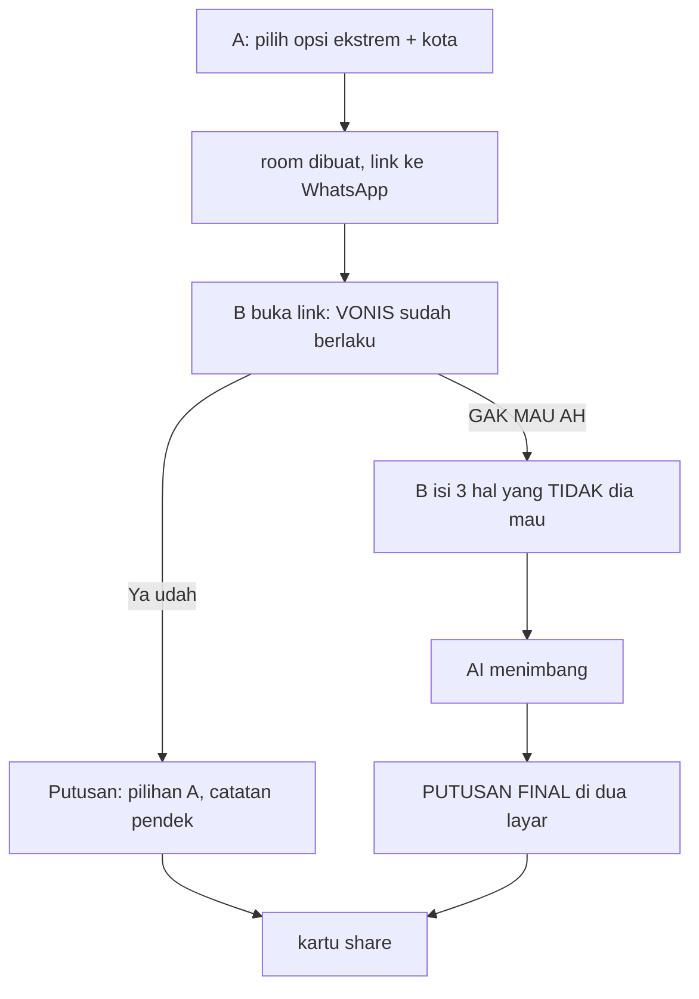

# Terserah Resolver — Design

Date: 2026-07-26
Status: validated, ready for implementation planning
Source: `Ide SaaS Unik Berbasis AI.pdf` (Gemini brainstorm transcript)

---

## 1. The problem and the mechanic

The conflict: one party says "terserah", which does not mean "you decide". It means
"guess what I want, but I won't say it". Every suggestion the other party makes gets
rejected. The loop is exhausting and it repeats weekly.

The psychological lever, correctly identified in the source: **people who say
"terserah" cannot articulate what they want, but they know exactly what they don't
want.** The product's only job is to extract the negative preferences without asking
for them directly.

### Mechanic chosen: asymmetric, default-wins, no timer

The source proposed a 5-minute countdown ("Jebakan Ultimatum"). Rejected for two
reasons:

1. **The timer breaks the flow.** A WhatsApp link is opened when it is opened —
   sometimes 40 minutes later. An expired room is a dead end, and the dead end is
   exactly the metric we are trying to beat.
2. **"Hak suara Anda dicabut" reads as an attack.** The viral loop only closes if the
   *receiving* party thinks it is funny. If B feels ambushed by their partner, they
   close the tab, and the app has started a fight instead of ending one.

The fix keeps the psychology and drops the failure mode: **A's choice is already
final the moment B opens the link.** No countdown. The pressure comes from a bad
option that is already in effect, not from a clock. B's loud button is `GAK MAU AH` —
which reframes the interaction from *"you are being punished"* to *"go on, complain"*.
Complaining is participation, and participation is what makes B share the result too.

### Flow



Both branches terminate in a shareable card. There is no path that ends in nothing.

### The single most important product rule

**The AI roasts both parties, always.** Not just B. The verdict note must land a jab
at A too — "Pihak A jelas cuma pengen warkop, bukan cari solusi." A one-sided roast
turns the app into a weapon A used on B, and B never shares it. A symmetric roast
means both people laugh and both people forward it. This is a hard constraint in the
system prompt, not a stylistic preference.

Corollary: copy is not gendered. The source framed it cowok/cewek; that halves the
market and alienates the recipient.

---

## 2. Where the restaurant data comes from

This was the open technical question in the source. The referenced article
([Nannapuneni, 2022](https://medium.com/@nagasameer/building-a-restaurant-picker-program-using-google-places-api-99aa3108310))
solves the adjacent problem — pull nearby restaurants, filter by keyword/price/radius,
pick one — with legacy Nearby Search from a Python CLI. The retrieval shape is right.
The API and the economics are not, and the difference decides the architecture.

### What Places actually costs (verified 2026-07-20 SKU tables)

The `$200` monthly credit is dead; billing is now per-SKU free caps, and the field
mask you send determines which SKU you are billed at — highest tier wins.

| Call | SKU | Free/mo | Then |
|---|---|---|---|
| Nearby Search, any fields (the article's approach) | Nearby Search Pro | 5,000 | **$32.00 / 1k** |
| Text Search asking for `displayName` | Text Search Pro | 5,000 | **$32.00 / 1k** |
| Text Search asking for `places.id` only | Text Search Essentials (IDs Only) | **Unlimited** | **free** |
| Place Details for `formattedAddress`, `location`, `types` | Place Details Essentials | 10,000 | $5.00 / 1k |

Nearby Search has no Essentials tier at all — every field on it, including the name,
bills at Pro. That is the trap in porting the article directly: one viral weekend at
50k rooms costs ~$1,440.

Note `displayName` is a **Pro** field. There is no cheap way to ask Google *"what is
this place called?"* — which is exactly why the LLM should keep that job.

### The design: Google validates, the LLM decides

Inverting the source's Approach 2 (where the LLM extracts a query and Google
retrieves) makes the whole thing free:

1. The LLM proposes a place from internal knowledge, enriched with A's city. Large
   franchises and well-known spots in Indonesian cities are well represented in
   training data; hallucination concentrates on small independents.
2. **Existence check.** Text Search with `textQuery: "<place>, <city>"` and field mask
   `places.id` — nothing else. Text Search Essentials (IDs Only): unlimited, free,
   forever. One result back means the place is real.
3. Zero results means the model invented it. Retry the LLM once, told the previous
   pick does not exist. Second miss falls through to the `maps_query` link below.

Google never has to name anything, so the bill never leaves the free tier no matter
how viral it gets. The LLM keeps the reasoning and the roast, which is the part that
is actually the product.

### The floor, if the key is missing or the check fails

The model also returns a `maps_query` string, and the card's `Buka di Maps` button
points at `https://www.google.com/maps/search/?api=1&query=<encoded>`. No key, no
quota, no SKU. Even an invented name lands the user on a real search in their city.
Ship this first; the existence check layers on top without changing the card.

### Deferred, with a trigger

One **Place Details Essentials** call (`formattedAddress`, `location`) to print a real
address and an exact pin instead of a search. 10,000 free/mo, then $5/1k. Add it when
users complain the Maps link is imprecise — not before.

`displayName`, `rating`, `priceLevel`, and opening hours are Pro/Enterprise fields.
The judge does not need them, and asking would move every call into the $32/1k band.

---

## 3. Architecture

### Stack

| Layer | Choice | Why not the alternative |
|---|---|---|
| Framework | Next.js 15 App Router, TypeScript | SSR needed for OG meta tags on the shared link |
| Styling | Tailwind v4 | tokens in CSS, no config file needed |
| Rooms | Upstash Redis | rooms are ephemeral JSON with a TTL, polled every 2s — a KV workload. Putting them in Postgres would mean a schema, migrations, and a cleanup job for a payload that deletes itself in 24h |
| Settings + history | Supabase Postgres | the two things that must outlive a room. Relational, queryable, durable — the opposite of the rooms workload, which is why both stores earn their place |
| Realtime | client polling, 2s | Upstash has no subscriptions; SSE needs a route handler that polls Redis anyway, so it is strictly more code for a screen that waits ~60s |
| LLM | Gemini via raw `fetch` | structured output via `responseSchema` in the request body is ~20 lines; an SDK adds a dependency for nothing. Model and temperature are admin-tunable, not env-baked |
| Rate limit | `@upstash/ratelimit` | same Redis, public unauthenticated LLM endpoint spends real money |
| OG image | `next/og` `ImageResponse` | the WhatsApp preview *is* the growth surface |
| Place check | Places API Text Search, `places.id` field mask only | Nearby Search and any name-bearing field mask bill at Pro, $32/1k after 5k. IDs-only Text Search is unlimited and free — see §2. Optional: the app works without the key |
| Admin auth | `ADMIN_PASSWORD` + HMAC-signed cookie | one admin. Supabase Auth would add a provider, a user table, and email config to gate a single person. Web Crypto so the same module runs in edge middleware |
| Host | Cloudflare Workers via `@opennextjs/cloudflare` | Next's Node runtime, not Edge, so route handlers survive unchanged. Three constraints it imposes are load-bearing — see §3.1 |

Skipped: realtime subscriptions, an LLM SDK, a server-rendered PNG download pipeline,
end-user accounts, an ORM, Supabase Auth, and any Places call that returns a name.

### 3.1 What Cloudflare Workers changed

Three constraints, each of which would have shipped as a silent production bug:

**Env is per-request.** `process.env` is populated when a request arrives, not at
isolate start, so every module-scope read captured `undefined`. The Supabase client,
both rate limiters, and the room store are now built lazily and memoized per isolate;
`hasAdmin`, `canStoreSecrets`, and `hasSupabase` became functions. The worst case was
`middleware.ts`, which imports the auth module and evaluates early — a module-scope
read there would have locked the admin panel shut on every deploy.

This also deleted complexity rather than adding it: the tests no longer need dynamic
imports to set env before module evaluation.

**No filesystem, and no fetching your own domain.** The OG route read its fonts with
`node:fs`. The obvious fix — serving them from `public/` and fetching — fails once
deployed, because a Worker cannot fetch its own public hostname
([opennextjs-cloudflare#602](https://github.com/opennextjs/opennextjs-cloudflare/issues/602)).
Fonts are inlined as base64 in `lib/og-fonts.ts`, generated by `npm run fonts`. One
code path under `next dev`, `next build`, and workerd; no binding, no network.

**Bundle size is a budget.** 2.0 MiB gzipped against a 3 MiB limit, ~130 KiB of that
the inlined fonts. `wrangler deploy --dry-run` reports it.

Rooms stay on Upstash Redis rather than moving to KV or Durable Objects. KV is
eventually consistent, which breaks a room polled every two seconds, and neither
swap was asked for. Upstash speaks HTTP and works unchanged on Workers.

### Data model

One Redis key per room, `room:<slug>`, `EX 86400`.

```ts
type Room = {
  id: string            // 6-char nanoid, url-safe
  city: string
  aChoice: string       // the deliberately bad option
  state: 'awaiting_b' | 'accepted' | 'protested' | 'decided'
  bDealbreakers?: string[]   // exactly 3
  verdict?: Verdict
  createdAt: number
}

type Verdict = {
  place: string        // ALL CAPS
  mapsQuery: string
  reasoning: string    // 1-2 sentences, roasts BOTH sides
}
```

TTL expiry is the `expired` state — the key vanishes and `/r/[id]` renders
"Sidang sudah ditutup". No cleanup job.

### State machine

`awaiting_b` → `accepted` → `decided`
`awaiting_b` → `protested` → `decided`

`decided` is terminal and idempotent: re-submitting against a decided room returns
the existing verdict rather than burning another LLM call.

### Routes

| Route | Purpose |
|---|---|
| `/` | landing + A's create form, one screen |
| `/r/[id]` | the room; renders by `state` and by viewer |
| `POST /api/room` | create; rate limited 5/hour/IP |
| `GET /api/room/[id]` | poll target for A's waiting screen |
| `POST /api/room/[id]/respond` | accept or protest; triggers the LLM on protest |
| `GET /api/og/[id]` | OG image, doubles as the "Simpan gambar" target |
| `/admin/login` | password gate; the only path the middleware lets through |
| `/admin` | riwayat: stats strip + filterable, paginated case table |
| `/admin/pengaturan` | tunable model, temperature, persona, place check, kill switch |
| `POST /api/admin/{login,logout,settings}` | rate limited 10/15min on login |

`middleware.ts` gates `/admin/*` and `/api/admin/*` in one place, so no page
re-checks and there is exactly one thing to get wrong.

Viewer identity: A gets a path-scoped `ta_<roomId>` cookie on create. No cookie for
that room means you are B. No accounts, no fingerprinting.

### AI contract

```json
{
  "place": "string, ALL CAPS, nama tempat yang spesifik",
  "maps_query": "string, 'nama tempat, kota'",
  "reasoning": "string, 1-2 kalimat, menyindir KEDUA pihak"
}
```

System prompt persona: an authoritative, dry, sarcastic judge. Formal register,
savage content — the humour comes from the mismatch. Must sindir both parties. Must
name exactly one place. Must not offer alternatives.

### Failure handling

Malformed JSON or timeout → retry once → fall back to a canned verdict returning A's
original choice ("Hakim sedang cuti. Keputusan dikembalikan ke Pihak A."). A blank
error screen is never acceptable on the surface that carries the whole loop.

Rate limit hit → a copy-consistent refusal screen, not a 429 body.

---

## 4. Interface

Full system in `DESIGN.md`. Summary of the committed direction:

**Night court.** Dark ink ground, one stamp-red brand color, and exactly one bright
object on screen — the decree card. Anton for the verdict, IBM Plex Mono for the
bureaucratic chrome. Formal document language wrapped around insulting content.

The source's neon-brutalism proposal was rejected: given "Gen Z viral roast app",
neon pink and thick black borders is what everyone guesses, and the obvious
anti-reflex (newspaper editorial, terminal green) is the same trap one tier down.

Three screens, mobile-first, all one viewport:

1. **`/` — the summons desk.** One statement, one field for the bad option, one for
   the city, one button. No feature grid, no pricing, no testimonials.
2. **`/r/[id]` for B — the decree in effect.** The verdict already rendered against
   them. Loud `GAK MAU AH`, quiet `Ya udah`. Readable and dismissible in three
   seconds, which is all B will give it.
3. **`/r/[id]` decided — the putusan.** One viewport, no scroll, so a screenshot
   captures it whole. Place, reasoning, `Buka di Maps`, `Bagikan` (Web Share API),
   `Simpan gambar`.

A's waiting screen polls and flips automatically when B responds.

Motion investment is concentrated in one beat: the deliberation sequence between B's
submit and the verdict — mono lines reading out like a court (`MENIMBANG…` →
`MENGADILI…` → `MEMUTUSKAN…`), then the card landing like a stamp on paper.
`prefers-reduced-motion` gets a static crossfade.

---

## 5. Admin

One operator, three jobs: watch whether the loop is working, tune the judge, and
stop the bleeding if it isn't.

### Riwayat

A row is written to `cases` at creation and updated at decision. That ordering is
the point: rows still sitting at `awaiting_b` are exactly the sessions where B never
engaged, which PRODUCT.md names as the primary metric to beat. The stats strip reads
abandonment, protest-vs-surrender split, judge failures, and median verdict latency
off the last 1,000 cases. Filters: all / decided / abandoned / judge-failed.

History is analytics and never a dependency of the user flow — every write swallows
its own failure. A broken Supabase must not cost anyone dinner.

### Pengaturan API

Tunable at runtime, cached 30s so the hot path stays off the network:

| Setting | Why it's worth a knob |
|---|---|
| `persona` | the system prompt is the product; iterating it is the main job |
| `provider` + `base_url` | any OpenAI-compatible endpoint, see below |
| `model` | Flash vs Pro is a real cost/sharpness trade |
| `temperature` | below 0.7 the verdicts flatten, above 1.4 the model invents places |
| `place_check` | cost/latency control on the free existence check |
| `paused` | kill switch for a viral spike, no redeploy |

A blank persona restores the shipped default rather than saving an empty system
prompt — the "roast both parties" rule is load-bearing and must not be removable by
clearing a textarea.

### Custom endpoints

Two adapters share one prompt and one parser: Gemini's native API, and any
OpenAI-compatible `/chat/completions`. Gemini native stays because it is the
zero-config default and its `responseSchema` is the most reliable structured output
available; the compatible adapter is what makes the provider a choice rather than a
deploy-time constant.

**Structured output degrades instead of exposing a knob.** Support is uneven across
OpenAI, OpenRouter, Groq, vLLM, Ollama, and LM Studio, so the adapter tries
`json_schema`, falls back to `json_object` on a 400/422, then to plain text, and the
parser digs JSON out of a code fence. An admin should not have to know which tier
their server implements.

`Uji koneksi` runs one real verdict against the unsaved form. A typo'd base URL is
the most likely failure mode here, and without the button it surfaces as a fallback
verdict for a real couple. Its error messages name the fix, not the exception.

**Reversal: the endpoint key is now storable.** The earlier rule — secrets never in
the database — assumed the only key was Gemini's, set once at deploy. Once the admin
can point at an arbitrary endpoint, a key they cannot change without a redeploy makes
that half a feature. Resolved by encrypting it: AES-GCM, master key in
`SETTINGS_ENCRYPTION_KEY`, so a Supabase snapshot alone does not read it, and the
value never returns to the browser. Absent the master key the field is disabled
rather than degrading to plaintext. The Gemini key stays env-only.

**Still not configurable.** The Places field mask is hardcoded to `places.id`
forever — any name-bearing field moves every call from free to $32/1k. The rate limit
is a deploy decision.

### Auth

`ADMIN_PASSWORD` plus an HMAC-signed cookie carrying its own expiry, verified in
`middleware.ts` with Web Crypto. Password comparison hashes both sides before a
constant-time compare, so length never leaks. Unset password means the panel is
locked shut, not wide open.

Supabase Auth was rejected: a provider, a user table, and email configuration to gate
one person.

---

## 6. Growth loop

Built into the mechanic, not bolted on. A cannot use the product without sending B a
link — every session recruits one new user. The WhatsApp preview (`/api/og/[id]`) is
seen by everyone in a group chat, not just B, so a group-shared link is a broadcast.

The verdict card is designed to be screenshotted; the watermark is the domain, small
and legible at Instagram Story compression.

TikTok launch format, from the source and worth keeping: split screen, real "terserah"
chat on top, the app issuing its verdict below.

---

## 7. Verification

**Automated** (`npm test`, 18 tests, node:test):

- Room state machine: the second responder loses, `decided` is terminal so a retry
  cannot buy a second model call, ids avoid lookalike characters, input cleaning and
  the exactly-three-dealbreakers rule.
- Verdict parser rejects malformed output and still recovers JSON from a code fence
  or from a model that narrates before answering.
- Admin auth: wrong password, tampered signature, an expiry extended without
  re-signing, and a genuinely expired token are all rejected.
- Settings validation, including that a blank persona restores the default and that a
  custom endpoint without a parseable http(s) base URL is refused at the boundary
  rather than falling back on every case.
- Base URL normalization for `/v1`, `/v1/`, trailing slashes, and a full
  `/chat/completions` path.
- Key handling: AES-GCM round-trip, a fresh IV per call, and null on tampered,
  truncated, or junk blobs. The three-state input, so editing the persona cannot wipe
  a stored key.
- Supabase wiring against a stub PostgREST server: query shape, blank-persona
  fallback, the 30s cache, invalidation on save, that the plaintext key never reaches
  the wire, and that the cipher never rides along in `getSettings()`.

**Exercised in-browser** (Chromium, 320 / 390 / 1280px):

- Both endings: protest → judge → decree, and surrender → brass "tanpa lawan" seal.
- A's waiting screen flipping to the verdict by poll, without a reload.
- The judge-unavailable fallback rendering as a real verdict, not an error screen.
- OG image rendering with vendored fonts and the stamp.
- Admin gate: unauthenticated page redirects, unauthenticated API returns 401, wrong
  password reports itself, correct password lands on riwayat.
- Riwayat table, stats strip, and all four filters against seeded rows; settings save
  round-tripping to the store; `paused` actually returning 503 to the public form.
- A full case decided through a custom OpenAI-compatible endpoint, against a mock
  local server that rejects `json_schema` and answers with fenced JSON: the adapter
  degraded to `json_object`, parsed the fence, and rendered a real decree. The key
  was read back decrypted from storage; the stored row held ciphertext only.
- `Uji koneksi` against a refused port, a bad hostname, and forced 401/404/429/500 —
  each produced its own actionable message, and the key was never echoed back.
- `prefers-reduced-motion` path, and zero horizontal overflow at 320px.
- Every color pair measured for contrast, not estimated — three failures found and
  fixed (`--stamp-deep`, `--seal-deep`, and small red text moved to `--stamp-lift`).

**Not yet verified:** a live Gemini key, a live Places key, a real hosted provider,
and a real Supabase project. All ran against stubs, mocks, or their documented
degradation path.

---

## 8. Deliberately not built

| Skipped | Add when |
|---|---|
| Place Details Essentials for exact address/pin | users complain the Maps search link is imprecise |
| Any Pro-tier Places field (`displayName`, rating, hours, price) | never — $32/1k, and the judge does not use them |
| Categories beyond food | the food loop retains |
| End-user accounts and streaks | someone asks twice; admin history already answers the operator's questions |
| Monetization | the loop is proven; then gate unlimited rooms or custom judge personas |
| 3+ party rooms | groups actually try it |
| English / i18n | the Indonesian market is saturated |
| Server-rendered share PNG | the OG endpoint already covers it |
