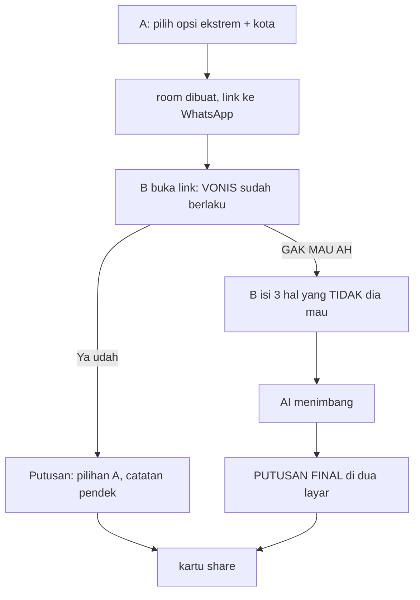

# Terserah Resolver — Design

Date: 2026-07-26
Status: validated, ready for implementation planning
Source: `Ide SaaS Unik Berbasis AI.pdf` (Gemini brainstorm transcript)

---

## 1. The problem and the mechanic

The conflict: one party says "terserah", which does not mean "you decide". It means
"guess what I want, but I won't say it". Every suggestion the other party makes gets
rejected. The loop is exhausting and it repeats weekly.

The psychological lever, correctly identified in the source: **people who say
"terserah" cannot articulate what they want, but they know exactly what they don't
want.** The product's only job is to extract the negative preferences without asking
for them directly.

### Mechanic chosen: asymmetric, default-wins, no timer

The source proposed a 5-minute countdown ("Jebakan Ultimatum"). Rejected for two
reasons:

1. **The timer breaks the flow.** A WhatsApp link is opened when it is opened —
   sometimes 40 minutes later. An expired room is a dead end, and the dead end is
   exactly the metric we are trying to beat.
2. **"Hak suara Anda dicabut" reads as an attack.** The viral loop only closes if the
   *receiving* party thinks it is funny. If B feels ambushed by their partner, they
   close the tab, and the app has started a fight instead of ending one.

The fix keeps the psychology and drops the failure mode: **A's choice is already
final the moment B opens the link.** No countdown. The pressure comes from a bad
option that is already in effect, not from a clock. B's loud button is `GAK MAU AH` —
which reframes the interaction from *"you are being punished"* to *"go on, complain"*.
Complaining is participation, and participation is what makes B share the result too.

### Flow



Both branches terminate in a shareable card. There is no path that ends in nothing.

### The single most important product rule

**The AI roasts both parties, always.** Not just B. The verdict note must land a jab
at A too — "Pihak A jelas cuma pengen warkop, bukan cari solusi." A one-sided roast
turns the app into a weapon A used on B, and B never shares it. A symmetric roast
means both people laugh and both people forward it. This is a hard constraint in the
system prompt, not a stylistic preference.

Corollary: copy is not gendered. The source framed it cowok/cewek; that halves the
market and alienates the recipient.

---

## 2. Where the restaurant data comes from

This was the open technical question in the source, and the answer for MVP is the
cheap one plus one guard.

**Approach:** LLM internal knowledge, enriched with the city A enters. Large
franchises and well-known local spots in Indonesian cities are well represented in
model training data; hallucination risk concentrates on small independent places.

**The guard:** the model also returns a `maps_query` string. The result card renders
a `Buka di Maps` button pointing at
`https://www.google.com/maps/search/?api=1&query=<encoded>`. If the model invents a
name, the Maps search still lands the user on something plausible in their city. Zero
API cost, zero keys, and it kills the worst failure mode.

Google Places API is deliberately **not** in the MVP. Add it when hallucination is
observed in real use, not before. It is a swap behind one function.

---

## 3. Architecture

### Stack

| Layer | Choice | Why not the alternative |
|---|---|---|
| Framework | Next.js 15 App Router, TypeScript | SSR needed for OG meta tags on the shared link |
| Styling | Tailwind v4 | tokens in CSS, no config file needed |
| Store | Upstash Redis | rooms are ephemeral JSON with a TTL — a KV workload, not relational. Supabase would mean schema, migrations, and a cleanup job for a payload that expires in 24h |
| Realtime | client polling, 2s | Upstash has no subscriptions; SSE needs a route handler that polls Redis anyway, so it is strictly more code for a screen that waits ~60s |
| LLM | Gemini 2.5 Flash via raw `fetch` | structured output via `responseSchema` in the request body is ~20 lines; an SDK adds a dependency for nothing. Model name is one env var |
| Rate limit | `@upstash/ratelimit` | same Redis, public unauthenticated LLM endpoint spends real money |
| OG image | `next/og` `ImageResponse` | the WhatsApp preview *is* the growth surface |
| Host | Vercel | — |

Skipped: Supabase + realtime subscriptions, an LLM SDK, a server-rendered PNG
download pipeline, accounts, an ORM.

### Data model

One Redis key per room, `room:<slug>`, `EX 86400`.

```ts
type Room = {
  id: string            // 6-char nanoid, url-safe
  city: string
  aChoice: string       // the deliberately bad option
  state: 'awaiting_b' | 'accepted' | 'protested' | 'decided'
  bDealbreakers?: string[]   // exactly 3
  verdict?: Verdict
  createdAt: number
}

type Verdict = {
  place: string        // ALL CAPS
  mapsQuery: string
  reasoning: string    // 1-2 sentences, roasts BOTH sides
}
```

TTL expiry is the `expired` state — the key vanishes and `/r/[id]` renders
"Sidang sudah ditutup". No cleanup job.

### State machine

`awaiting_b` → `accepted` → `decided`
`awaiting_b` → `protested` → `decided`

`decided` is terminal and idempotent: re-submitting against a decided room returns
the existing verdict rather than burning another LLM call.

### Routes

| Route | Purpose |
|---|---|
| `/` | landing + A's create form, one screen |
| `/r/[id]` | the room; renders by `state` and by viewer |
| `POST /api/room` | create; rate limited 5/hour/IP |
| `GET /api/room/[id]` | poll target for A's waiting screen |
| `POST /api/room/[id]/respond` | accept or protest; triggers the LLM on protest |
| `GET /api/og/[id]` | OG image, doubles as the "Simpan gambar" target |

Viewer identity: A gets a `terserah_a=<roomId>` cookie on create. No cookie for that
room means you are B. No accounts, no fingerprinting.

### AI contract

```json
{
  "place": "string, ALL CAPS, nama tempat yang spesifik",
  "maps_query": "string, 'nama tempat, kota'",
  "reasoning": "string, 1-2 kalimat, menyindir KEDUA pihak"
}
```

System prompt persona: an authoritative, dry, sarcastic judge. Formal register,
savage content — the humour comes from the mismatch. Must sindir both parties. Must
name exactly one place. Must not offer alternatives.

### Failure handling

Malformed JSON or timeout → retry once → fall back to a canned verdict returning A's
original choice ("Hakim sedang cuti. Keputusan dikembalikan ke Pihak A."). A blank
error screen is never acceptable on the surface that carries the whole loop.

Rate limit hit → a copy-consistent refusal screen, not a 429 body.

---

## 4. Interface

Full system in `DESIGN.md`. Summary of the committed direction:

**Night court.** Dark ink ground, one stamp-red brand color, and exactly one bright
object on screen — the decree card. Anton for the verdict, IBM Plex Mono for the
bureaucratic chrome. Formal document language wrapped around insulting content.

The source's neon-brutalism proposal was rejected: given "Gen Z viral roast app",
neon pink and thick black borders is what everyone guesses, and the obvious
anti-reflex (newspaper editorial, terminal green) is the same trap one tier down.

Three screens, mobile-first, all one viewport:

1. **`/` — the summons desk.** One statement, one field for the bad option, one for
   the city, one button. No feature grid, no pricing, no testimonials.
2. **`/r/[id]` for B — the decree in effect.** The verdict already rendered against
   them. Loud `GAK MAU AH`, quiet `Ya udah`. Readable and dismissible in three
   seconds, which is all B will give it.
3. **`/r/[id]` decided — the putusan.** One viewport, no scroll, so a screenshot
   captures it whole. Place, reasoning, `Buka di Maps`, `Bagikan` (Web Share API),
   `Simpan gambar`.

A's waiting screen polls and flips automatically when B responds.

Motion investment is concentrated in one beat: the deliberation sequence between B's
submit and the verdict — mono lines reading out like a court (`MENIMBANG…` →
`MENGADILI…` → `MEMUTUSKAN…`), then the card landing like a stamp on paper.
`prefers-reduced-motion` gets a static crossfade.

---

## 5. Growth loop

Built into the mechanic, not bolted on. A cannot use the product without sending B a
link — every session recruits one new user. The WhatsApp preview (`/api/og/[id]`) is
seen by everyone in a group chat, not just B, so a group-shared link is a broadcast.

The verdict card is designed to be screenshotted; the watermark is the domain, small
and legible at Instagram Story compression.

TikTok launch format, from the source and worth keeping: split screen, real "terserah"
chat on top, the app issuing its verdict below.

---

## 6. Verification

- One test file covering the room state machine transitions (including that `decided`
  is idempotent and does not re-invoke the LLM) and that the verdict parser rejects
  malformed model output and falls back cleanly.
- Manual smoke: create a room in one browser, open the link in a second profile,
  run both the accept and the protest branch, confirm A's screen flips without a
  reload and that the OG preview renders in a real WhatsApp message.
- Every heading checked at 320px — Anton at a large clamp overflows fast.

---

## 7. Deliberately not built

| Skipped | Add when |
|---|---|
| Google Places API | hallucinated places show up in real sessions |
| Categories beyond food | the food loop retains |
| Accounts, history, streaks | someone asks twice |
| Monetization | the loop is proven; then gate unlimited rooms or custom judge personas |
| 3+ party rooms | groups actually try it |
| English / i18n | the Indonesian market is saturated |
| Server-rendered share PNG | the OG endpoint already covers it |
